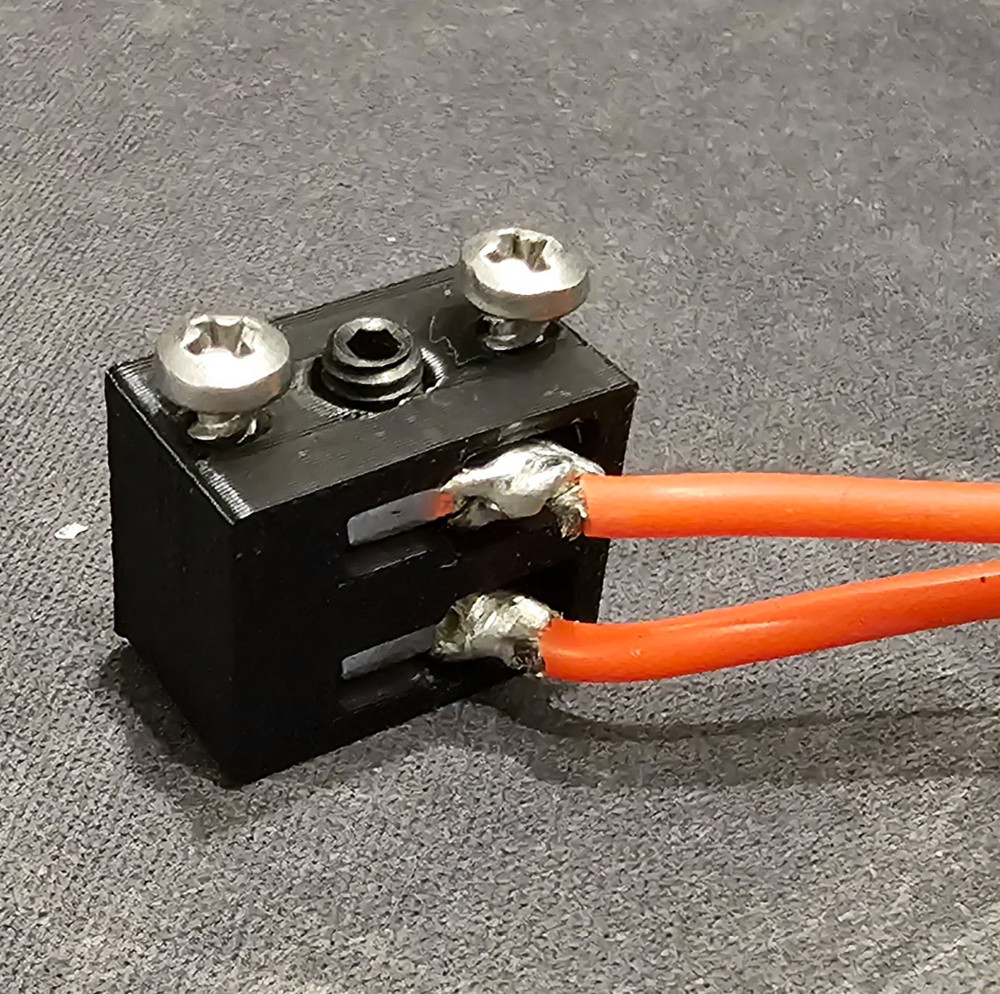
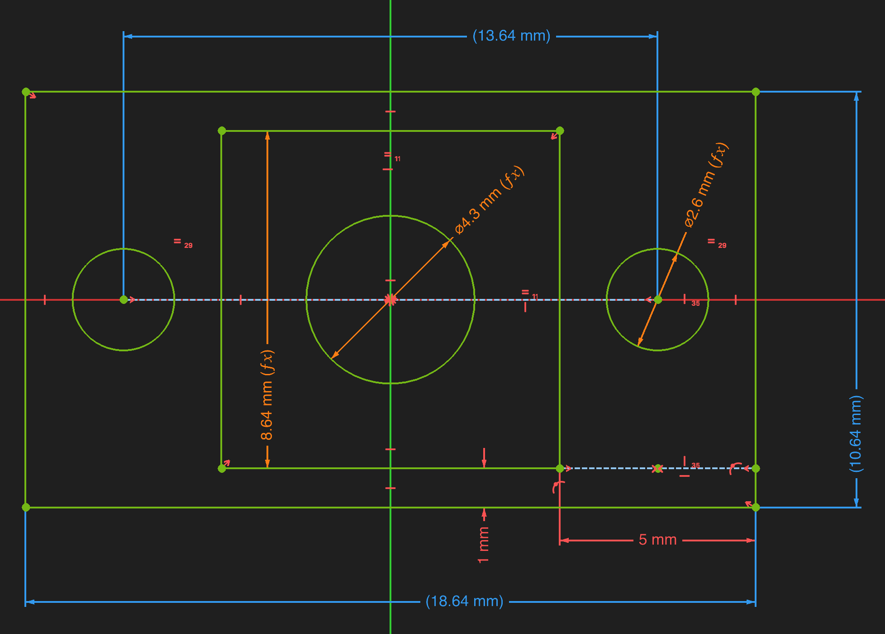

# RobotScrewSwitch-CAD

This is a project inspired by [this video](https://youtu.be/JzPqw-R81Io?si=6OAaGXtyz0344GNZ).

This project uses FreeCad and the Fasteners Workbench.

## Building

For a BOM check the spreadsheet 'BOM' inside the file. Watch the video once through to get a
general idea of what is going on then look back at the model. I ***super*** recommend using a
center punch before drilling. I used a 1/16th inch bit to make the holes. If you start a hole
and think it is going to be too close to the edge or too close to the threads, stop and try
again. It took me a few tries to figure out what I was doing, just dont go too far and it
will all work out.

## Costs

From my local hardware store, I bought a $6 center punch, a $5 1/16th inch metal bit, probably
something like $0.90 for two square nuts, and $0.70 for a set screw.

## Performance

I don't know yet, I will update soon. I measured resistance and found it to be too low for my
multmeter to pick up on. So its probably fine. It weighs ~8.9g with wires and all hardware.

## Use in other projects

I included `./RobotScrewSwitch.step` for a high poly high detail render and
`./Simplified-RobotScrewSwitch.step` for a more practical low poly render for use in actual CAD
work.

Above is a screen shot of the master sketch with all constraints and dimensions. This should
aid in creating a proper mounting/placement within your project.

## License

Do what you want; dont blame me if you break something. I am not liable. Be safe :)
